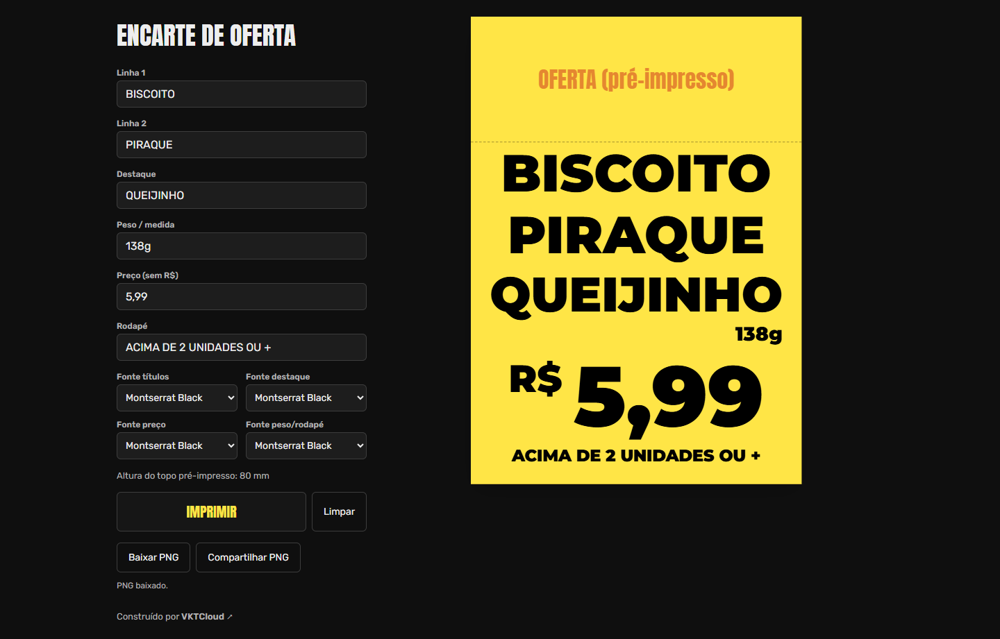

<div align="center">

# Encarte de Oferta

### Promoções em destaque. Impressão só em preto.

**A4 · Ajuste automático · 9 fontes · PHP + cPanel**

[Começar](#instalação-no-cpanel) · [Manual completo](https://vktcloud.com.br/encarte/manual.html) · [Manual visual](docs/manual.html) · [Impressão](#impressão)

</div>

<p align="center">



  
</p>


---

## Sobre o projeto

Gerador de cartazes de promoção para **papel A4 amarelo com o topo “OFERTA” já impresso**. Digite o produto, a medida, o preço e a condição da oferta: o sistema calcula os tamanhos das letras, respeita a largura disponível e distribui as linhas pela altura livre.

A página tem tema escuro e crédito com link para [VKTCloud](https://vktcloud.com.br/). O amarelo e a indicação do topo são apenas uma referência na tela. Na impressão, sai **somente o texto preto**, preservando a economia de tinta.

> **Versão para cPanel:** PHP entrega a página; JavaScript faz a edição, o redimensionamento e a impressão no navegador. Não requer banco de dados, Composer, Node.js ou chaves de API.

## Recursos

| Recurso | Resultado |
| :--- | :--- |
| Seis campos | Duas linhas de título, destaque, medida, preço e rodapé |
| Ajuste automático | Letras crescem até os limites de largura e altura |
| Quatro seletores de fonte | Títulos, destaque, preço e medida/rodapé independentes |
| Nove opções de fonte | Incluídas localmente na versão PHP |
| Topo fixo | Reserva de 80 mm para o papel pré-impresso |
| Unidades minúsculas | `138G` → `138g`; `2 KG` → `2 kg`; `350ML` → `350ml` |
| Memória no navegador | Textos e escolhas conservados no mesmo navegador |
| Saída PNG | Download, compartilhamento e imagem para impressão A4 |

## Instalação no cPanel

1. Abra **Gerenciador de Arquivos** no cPanel.
2. Crie a pasta `public_html/encarte`.
3. Envie os arquivos da versão PHP para essa pasta. Se recebeu um ZIP, use **Extrair**.
4. Confira que `index.php`, `assets/` e `licencas/` estão diretamente em `public_html/encarte`.
5. Acesse o seu domínio seguido de `/encarte/`.

**Se está usando este repositório completo**, envie o **conteúdo de `exports/cpanel/`**, e não o projeto inteiro. Se o repositório contém apenas a versão PHP, envie os arquivos da raiz.

### Requisitos

- Hospedagem com PHP; recomenda-se PHP **8.1 ou mais recente**.
- Chrome ou Edge atualizado, com JavaScript habilitado.
- Impressora compatível com A4 para impressão física.
- HTTPS recomendado, especialmente se restringir o acesso com senha.

## Uso rápido

1. Preencha os textos e o preço **sem `R$`**.
2. Escolha as fontes de cada grupo.
3. Use papel com 80 mm reservados ao topo pré-impresso.
4. Confira a prévia.
5. Clique em **IMPRIMIR**.

> O topo é fixo em **80 mm**, inclusive ao recuperar edições antigas.

## Impressão

| Configuração | Valor |
| :--- | :--- |
| Papel | A4, retrato |
| Escala | 100% |
| Margens do navegador | Nenhuma |
| Cabeçalhos e rodapés | Desativados |

O botão imprime **uma imagem PNG em uma única folha A4**. O navegador não permite impor a seleção de páginas ou impedir que o usuário escolha uma impressora virtual; selecione página **1** e uma cópia. Faça uma impressão física de teste.

## Exportar e compartilhar

**Baixar PNG** entrega `encarte.png`, 2480 × 3508 px, com fundo transparente e texto preto. **Compartilhar PNG** abre o compartilhamento do dispositivo quando suportado; escolha WhatsApp. Sem suporte, baixa a imagem para anexar manualmente. O topo, o amarelo e o crédito não entram na imagem.

## Fontes

**Padrões:** Montserrat Black nos títulos, Bebas Neue no destaque, Anton no preço e Roboto Bold na medida/rodapé.

As opções **Impact, Arial Black, Futura e Calibri** são apresentadas com seus equivalentes **Anton, Archivo Black, Jost e Carlito**. Não são os arquivos das fontes comerciais originais. As licenças das fontes distribuídas estão em `licencas/` dentro da versão PHP.

## Privacidade e limites

- Os textos ficam no armazenamento local do navegador; não são salvos na hospedagem.
- Não há login, sincronização, catálogo ou histórico de ofertas.
- A página é pública por padrão; use **Privacidade do Diretório** no cPanel para limitar o acesso.
- O preço é texto livre: não há validação de moeda nem cálculo de desconto.
- As regras de unidades implementadas não constituem certificação jurídica de conformidade.

## Documentação

- [Manual completo em Markdown](docs/DOCUMENTACAO.md)
- [Manual visual em HTML](docs/manual.html) — baixe ou abra em um navegador.

## Desenvolvimento

### Versão PHP

Na pasta que contém o `index.php`:

```sh
php -S localhost:8000
```

Acesse `http://localhost:8000`. Esse servidor é apenas para desenvolvimento, não para produção.

### Aplicação original neste repositório

A versão original usa TanStack Start, React, TypeScript e Tailwind CSS e permanece independente do pacote cPanel.

```sh
bun install
bun run dev
```

Para testar a formatação das duas versões:

```sh
bunx vitest run src/lib/formatar.test.ts src/lib/cpanel-formatar.test.ts
```

## Licenciamento

As fontes possuem suas próprias licenças, incluídas no pacote. **Não foi definida uma licença de distribuição para o código da aplicação**; adicione uma licença apropriada antes de autorizar reutilização pública.

---

<div align="center">

**Encarte de Oferta** · Feito para a rotina de promoções no varejo.

</div>

